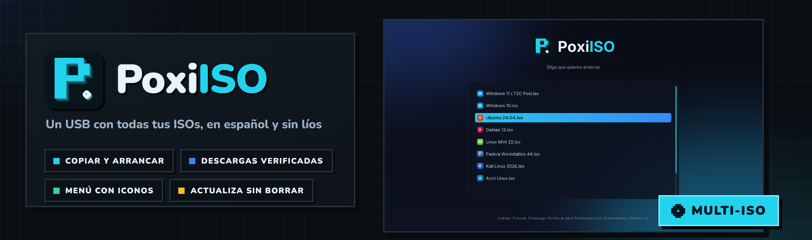
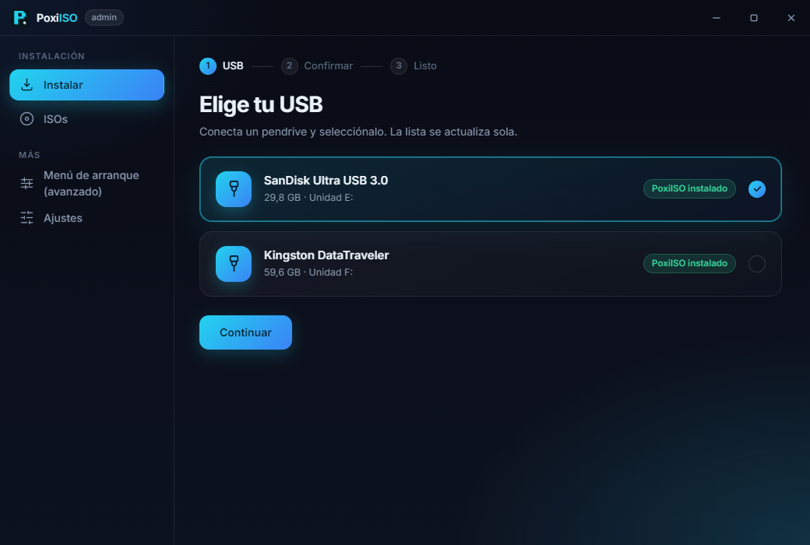
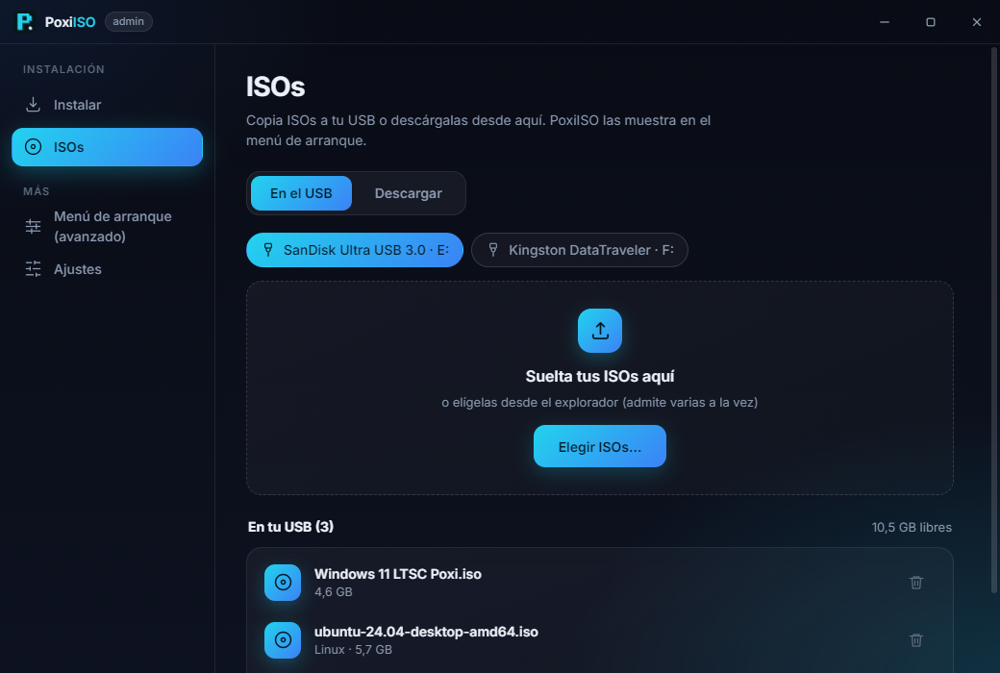
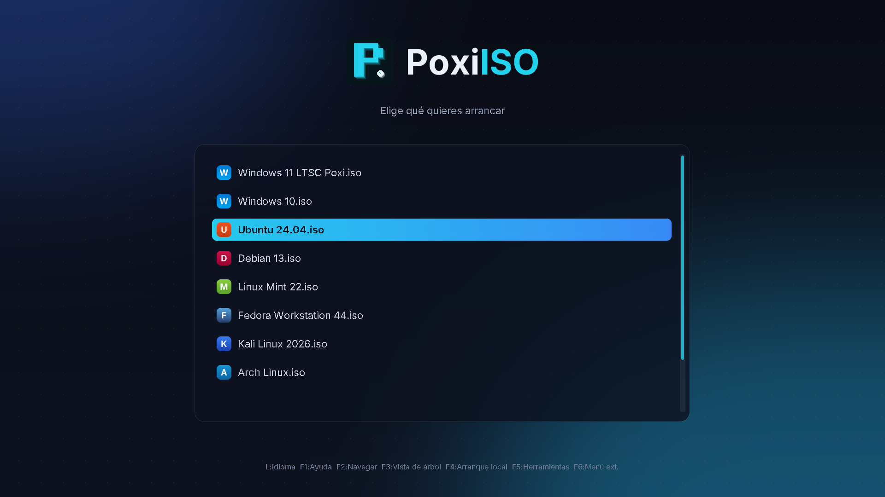
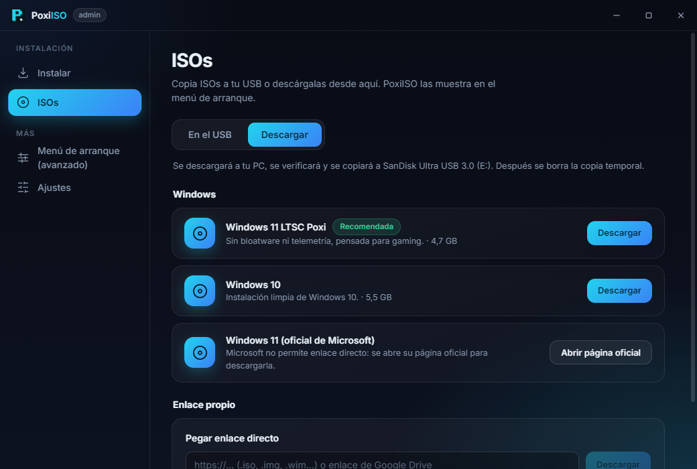

<div align="center">



<br />


**🇪🇸 Español** · [🇬🇧 English](#-english)

### Un USB con **todas tus ISOs**, en español y sin líos.

Instalas PoxiISO en el pendrive, copias las ISOs que quieras y al arrancar **eliges cuál**.
Sin formatear cada vez, sin herramientas en inglés y con las descargas de Windows y Linux **dentro de la app**.

</div>

---

## 🎯 Qué es

**PoxiISO** convierte un pendrive en un **USB de arranque multi-ISO**: Windows, Linux, herramientas de rescate… todas
en el mismo USB, y al encender el PC eliges cuál arrancar en un menú propio.

Está basado en [**Ventoy**](https://github.com/ventoy/ventoy), el motor multi-ISO que usan millones de personas. El
motor es el original y **no se modifica**; lo nuevo es todo lo que ves: el instalador, el gestor de ISOs, las
descargas, el menú de arranque y el configurador avanzado, todo en castellano y con el estilo de la familia Poxi.

## 📸 Así se ve

<table>
  <tr>
    <td width="50%"></td>
    <td width="50%"></td>
  </tr>
  <tr>
    <td align="center"><sub>🧭 Instalar en 3 pasos: eliges el USB, confirmas y listo</sub></td>
    <td align="center"><sub>💿 Arrastra tus ISOs al USB y mira lo que ya tienes</sub></td>
  </tr>
  <tr>
    <td width="50%"></td>
    <td width="50%"></td>
  </tr>
  <tr>
    <td align="center"><sub>🚀 El menú al arrancar: oscuro, en español y con un icono por sistema</sub></td>
    <td align="center"><sub>⬇️ Windows y Linux para descargar, verificados y directos al USB</sub></td>
  </tr>
</table>

## 📥 Descarga

| Archivo | Para qué |
|---|---|
| **[`PoxiISO-Setup-1.0.0.exe`](https://github.com/PoxiiTV/PoxiISO/releases/download/v1.0.0/PoxiISO-Setup-1.0.0.exe)** | **Instalador** (0,7 MB): baja el resto y crea los accesos |
| [`PoxiISO-Portable-1.0.0.exe`](https://github.com/PoxiiTV/PoxiISO/releases/download/v1.0.0/PoxiISO-Portable-1.0.0.exe) | **Portable**: se abre tal cual, sin instalar nada |
| **[`PoxiISO-1.0.0-mac-arm64.dmg`](https://github.com/PoxiiTV/PoxiISO/releases/download/v1.0.0/PoxiISO-1.0.0-mac-arm64.dmg)** | **Mac con Apple Silicon** (M1 o posterior), macOS 13+ · *beta* |
| [`PoxiISO-1.0.0-mac-x64.dmg`](https://github.com/PoxiiTV/PoxiISO/releases/download/v1.0.0/PoxiISO-1.0.0-mac-x64.dmg) | **Mac con Intel**, macOS 13+ · *beta* |

Todas las versiones y sus novedades, en [**Releases**](https://github.com/PoxiiTV/PoxiISO/releases).

> ℹ️ Como el `.exe` aún no está firmado, Windows puede enseñar el aviso azul de SmartScreen:
> **Más información → Ejecutar de todas formas.** Pide **administrador** porque tiene que preparar el USB.

> 🍎 Como la app aún no está firmada por Apple, macOS la bloquea la primera vez. Ábrela, cierra el aviso y ve a
> **Ajustes del Sistema → Privacidad y seguridad → Abrir igualmente**. Al instalar en el USB te pide la **contraseña
> del Mac**, porque tiene que escribir en el disco.

---

## 🌟 Lo que lo hace distinto

| | |
|---|---|
| 💿 **Copiar y arrancar** | Instalas una vez y a partir de ahí solo **copias ISOs** al USB. Arrastra varias a la vez: se copian con progreso, se pueden cancelar y **nunca** dejan archivos a medias ni pisan los que ya tienes |
| 🛡️ **Instalar sin sustos** | Antes de borrar te dice qué USB es y cuánto ocupa, y hay que **mantener pulsado** para confirmar. **Actualizar** no toca tus ISOs |
| ⬇️ **Más de 60 sistemas para descargar** | Windows, Ubuntu, Debian y Kali a mano, y el resto con **buscador**: Linux de todo tipo (Mint, Zorin, Pop!_OS, Fedora…), gaming (Bazzite, CachyOS, Nobara), rescate (Hiren's, Rescuezilla, GParted, Clonezilla), servidores (Proxmox, TrueNAS, Rocky, AlmaLinux) y más |
| ✅ **Verificadas** | Casi todas se comprueban con su **SHA-256 oficial** (las que no lo publican se avisan). Si se corta la conexión, **se reanuda**; al terminar se copia al USB y se borra la copia temporal |
| 🔗 **Tu propio enlace** | Pega cualquier enlace a una ISO, también los de **Google Drive** para compartir |
| 👀 **Vista previa** | Mira desde la app cómo se verá el menú al arrancar, con tus ISOs y sus iconos |
| 🎨 **Menú de arranque propio** | Tema oscuro cian, panel de cristal, **icono para cada sistema**, barra de desplazamiento y atajos en castellano. En 1080p y en pantallas 4:3 |
| 🧩 **Configurador avanzado** | El Plugson de Ventoy, **traducido entero** y con una explicación *«¿Qué es esto?»* en cada pantalla: alias, contraseñas, persistencia, instalaciones desatendidas… |
| 🌍 **Español o inglés** | La app, el menú de arranque y el configurador, en el idioma que elijas en **Ajustes** |

## 🚀 Cómo se usa

1. Abre PoxiISO, elige tu USB y pulsa **Instalar** (mantén pulsado para confirmar).
2. En **ISOs**, arrastra tus ISOs o descárgalas desde la pestaña **Descargar**.
3. Arranca el PC desde el USB (normalmente con `F8`, `F11`, `F12` o `Esc`) y elige la ISO.

¿Ya tienes PoxiISO o Ventoy en el USB? Pulsa **Actualizar**: cambia el sistema de arranque y **conserva tus archivos**.

## ⚠️ Avisos

- 🧹 **Instalar borra todo el USB.** Actualizar no. Usa un pendrive sin nada importante.
- 🪟 Google Drive a veces corta las descargas grandes con «cuota excedida»: espera un rato o usa la página oficial de Microsoft.
- 🔒 PoxiISO no incluye ninguna ISO: solo enlaza a los servidores oficiales y a las ISOs de Poxi.
- 🍎 **La versión de Mac es beta**: el instalador está probado con discos virtuales y arrancando en una máquina virtual
  (UEFI y BIOS), pero **todavía no con un USB real**. Si algo falla, cuéntalo en *Issues*.
- 🍎 En Mac el USB se prepara para **arrancar PCs**: un Mac con Apple Silicon no arranca ISOs de PC. En Mac no hay
  NTFS (exFAT o FAT32) ni configurador avanzado, que solo existe para Windows. **Expulsa el USB** antes de desenchufarlo.

---

## 🔧 Compilar

Requiere Node 20+, Python 3 y Windows. La versión de Mac se compila desde la rama `mac` (Node 20+, sin Python; los
detalles, en su `docs/MAC.md`).

```bat
start.bat          :: compila y abre PoxiISO en modo desarrollo (desde una terminal de administrador para instalar)
npm run engine     :: descarga Ventoy (verifica SHA-256) y genera el configurador en español e inglés
npm test           :: tests (solo carpetas temporales, nunca tocan unidades)
npm run dist       :: instalador + portable en release\
```

### 🗃️ Estructura

```
src/main/        proceso principal: instalar, ISOs, descargas, catálogo
src/renderer/    interfaz: asistente, gestor de ISOs, descargas y ajustes
i18n/            textos de la app (es.json, en.json)
boot-theme/      tema del menú de arranque e iconos por sistema
plugson/         traducción y estilo del configurador avanzado
data/isos.json   catálogo de descargas (se puede actualizar sin sacar versión)
scripts/         motor de Ventoy, icono y utilidades de compilación
```

Más detalles en [`docs/ESTADO.md`](docs/ESTADO.md) y las novedades en [`CHANGELOG.md`](CHANGELOG.md).

## 🙏 Gracias a

- [**Ventoy**](https://www.ventoy.net) (longpanda): todo el mérito del motor de arranque es suyo. Si te sirve, apóyale.
- [**Inter**](https://rsms.me/inter/) (Rasmus Andersson): la tipografía de la app, del menú y del configurador.

## 📜 Licencia

PoxiISO es software libre bajo **[GPL-3.0](LICENSE)**, como Ventoy. Las licencias de terceros están en
[`THIRD-PARTY.md`](THIRD-PARTY.md).

---

## 🇬🇧 English

<div align="center">

### One USB with **all your ISOs**, in Spanish and hassle-free.

</div>

## 🎯 What it is

**PoxiISO** turns a pen drive into a **multi-ISO boot USB**: Windows, Linux, rescue tools… all on the same USB, and
when the PC starts you pick which one to boot from its own menu. It is built on [**Ventoy**](https://github.com/ventoy/ventoy):
the engine is the original one and is **not modified**; everything you see is new: installer, ISO manager, downloads,
boot menu and advanced configurator, in Spanish (English available) and in the Poxi family style.

## 📥 Download

| File | What for |
|---|---|
| **[`PoxiISO-Setup-1.0.0.exe`](https://github.com/PoxiiTV/PoxiISO/releases/download/v1.0.0/PoxiISO-Setup-1.0.0.exe)** | **Installer** (0.7 MB): downloads the rest and creates the shortcuts |
| [`PoxiISO-Portable-1.0.0.exe`](https://github.com/PoxiiTV/PoxiISO/releases/download/v1.0.0/PoxiISO-Portable-1.0.0.exe) | **Portable**: runs as is, nothing to install |
| **[`PoxiISO-1.0.0-mac-arm64.dmg`](https://github.com/PoxiiTV/PoxiISO/releases/download/v1.0.0/PoxiISO-1.0.0-mac-arm64.dmg)** | **Apple Silicon Mac** (M1 or later), macOS 13+ · *beta* |
| [`PoxiISO-1.0.0-mac-x64.dmg`](https://github.com/PoxiiTV/PoxiISO/releases/download/v1.0.0/PoxiISO-1.0.0-mac-x64.dmg) | **Intel Mac**, macOS 13+ · *beta* |

> ℹ️ The `.exe` is not signed yet, so Windows may show the blue SmartScreen warning:
> **More info → Run anyway.** It asks for **administrator** rights because it has to prepare the USB.

> 🍎 The app is not signed by Apple yet, so macOS blocks it the first time. Open it, close the warning and go to
> **System Settings → Privacy & Security → Open Anyway**. Installing to the USB asks for your **Mac password**.

## 🌟 What makes it different

- 💿 **Copy and boot**: install once, then just copy ISOs. Cancellable copies with progress that never leave half-written files.
- 🛡️ **No scares**: you must **hold** the button to confirm the erase; **Update** keeps your ISOs.
- ⬇️ **Over 60 systems to download**: Windows, Ubuntu, Debian and Kali up front, the rest with **search**: desktop Linux, gaming (Bazzite, CachyOS, Nobara), rescue tools (Hiren's, Rescuezilla, GParted, Clonezilla), servers (Proxmox, TrueNAS) and more.
- ✅ **Verified**: every Linux image is checked against its **official SHA-256**; interrupted downloads **resume**.
- 🔗 **Your own link**, including Google Drive share links.
- 👀 **Boot preview**: see from the app how the boot menu will look, with your ISOs and their icons.
- 🎨 **Custom boot menu**: dark cyan theme, **an icon per system**, scrollbar, 1080p and 4:3.
- 🧩 **Advanced configurator**: Ventoy's Plugson, fully translated, with a *"What is this?"* explanation on every screen.
- 🌍 **Spanish or English**: app, boot menu and configurator follow the language chosen in **Settings**.

## ⚠️ Notices

- 🧹 **Install erases the whole USB.** Update does not.
- 🔒 PoxiISO ships no ISO files: it only links to official servers and Poxi's own ISOs.
- 🍎 **The Mac version is a beta**: tested with virtual disks and booting in a virtual machine (UEFI and BIOS), **not
  yet with a real USB**. The USB is for booting PCs (Apple Silicon Macs can't boot PC ISOs); no NTFS and no advanced
  configurator on Mac. **Eject the USB** before unplugging it.

## 🔧 Building

Node 20+, Python 3 and Windows (the Mac version builds from the `mac` branch, see its `docs/MAC.md`). `npm run engine` downloads Ventoy and builds the configurator, `npm test` runs the
tests (temporary folders only) and `npm run dist` creates the installer and the portable build in `release\`.

## 📜 License

Free software under **[GPL-3.0](LICENSE)**, like Ventoy. All credit for the boot engine goes to
[Ventoy](https://www.ventoy.net) (longpanda). Third-party licenses in [`THIRD-PARTY.md`](THIRD-PARTY.md).
